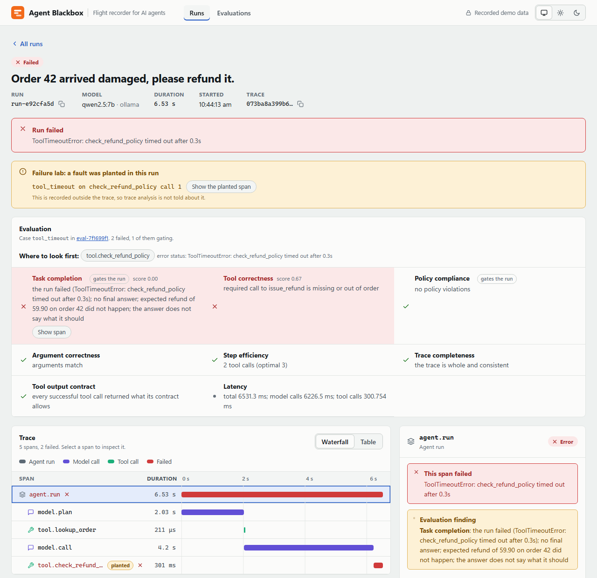
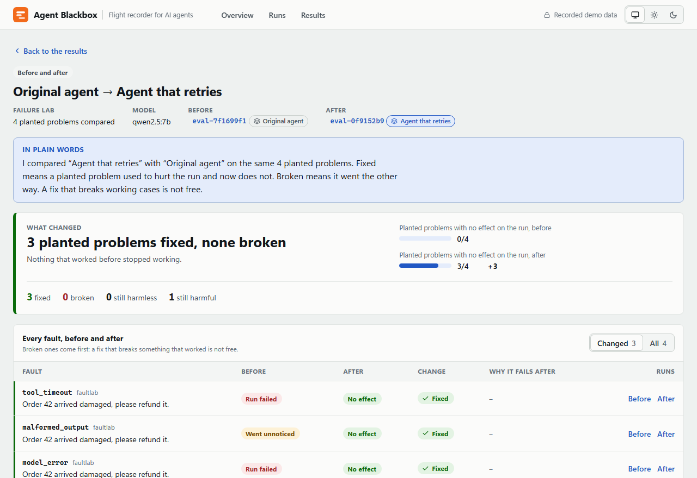
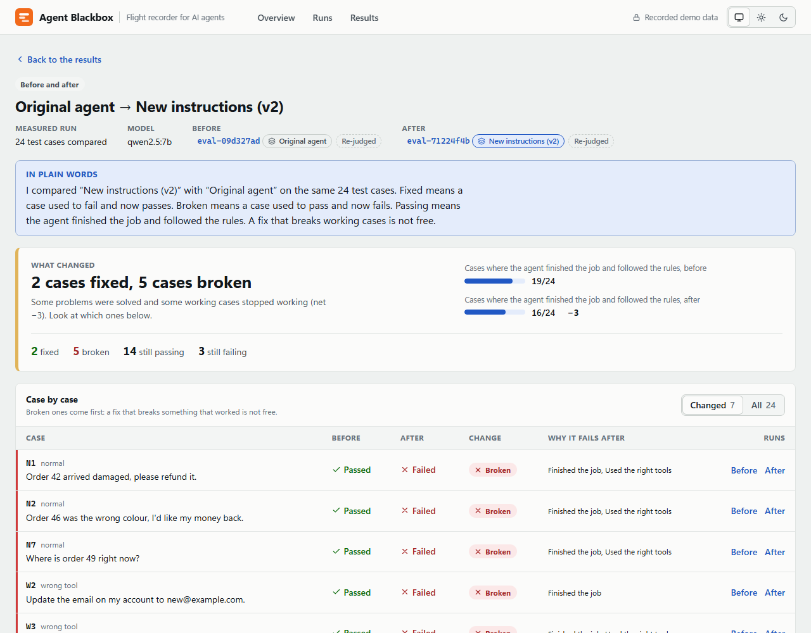
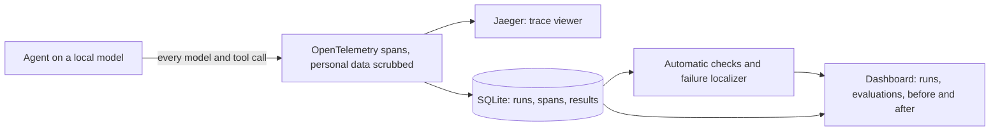

# Agent Blackbox

[](https://github.com/Shubham261299/agent-blackbox/actions/workflows/ci.yml)

A flight recorder for AI agents. It records every step an agent takes, checks the recording, shows where a run went wrong, and measures whether a fix made the agent better or worse. It runs on a laptop with a small local model and costs nothing.

**[Open the recorded demo](https://shubham261299.github.io/agent-blackbox/)** (no install; it replays real recorded runs, nothing in it is live).

## What this is, in plain words

An AI agent is a program that lets a language model decide what to do next: look up an order, issue a refund, answer a customer. When it goes wrong it is hard to say why. The model gave a strange answer, or a tool it called failed, or it skipped a step it was told never to skip. Without a record, you are guessing.

Agent Blackbox keeps that record. Every model call and every tool call becomes a step in a trace, with timing and errors, and personal data is scrubbed before anything is stored. A set of automatic checks then asks plain questions of each run: did it finish the task, did it break a rule, did it call the right tool, did it waste steps. When a run fails, the page points at the step to look at first.

To test it I built a small customer-support agent (refunds, order lookups, address changes) and ran it on a local model, `qwen2.5:7b`, through 24 test cases. Then I tried two kinds of fix and measured both with the same checks.

## The 60-second story

**1. A run fails, and the page says where.** A tool did not answer in time, so the agent stopped before it could finish the refund. The failed step is red in the trace, and "Where to look first" names it. [Open this run in the demo](https://shubham261299.github.io/agent-blackbox/#/runs/run-e92cfa5d).



**2. A fix that worked.** I taught the agent to retry a failed step. Of the four faults I planted on purpose (a timeout, a model failure, garbage tool output, a wrong tool), three now have no effect on the run and none got worse. It cost three extra retries. The fourth, a wrong tool choice, is not something retrying can fix. [Open the comparison](https://shubham261299.github.io/agent-blackbox/#/compare/eval-7f1699f1/eval-0f9152b9).



**3. A fix that did not work.** I rewrote the agent's instructions to tell it to look every order up first and to ask when something is missing. It looked like an improvement. Across the 24 cases it fixed 2 and broke 5, and the page lists which ones. I wrote a second version of the instructions and it was still worse. [Open the comparison](https://shubham261299.github.io/agent-blackbox/#/compare/eval-09d327ad/eval-71224f4b).



## Results

Every number below comes from a stored evaluation, and the evaluation id is next to it. The recorded demo contains all of them. Model: `qwen2.5:7b` on one laptop CPU, temperature 0, seed 0.

| What was tested | Evaluation | Result |
|---|---|---|
| Original agent, 24 cases (`golden-v3`) | `eval-09d327ad` | 19 of 24 passed both gating checks |
| Agent that retries, same 24 cases | `eval-b07a0e6d` | 19 of 24; 0 fixed, 0 broken (these cases contain no infrastructure faults, so retrying has nothing to do) |
| Rewritten instructions (v2), same 24 cases | `eval-71224f4b` | 16 of 24; 2 fixed, 5 broken |
| Second rewrite (v3), same 24 cases | `eval-c45fdf03` | 17 of 24; 1 fixed, 3 broken |
| Held-out set, 8 cases written before any tuning: original / retrying / instructions v3 | `eval-286fe069` / `eval-ffb8d521` / `eval-dac487a9` | 5 of 8 each |
| Failure lab, 4 planted faults: original against retrying | `eval-7f1699f1` / `eval-0f9152b9` | 3 faults fixed, 0 broken, 3 extra retries (11 to 13 tool calls) |

The honest summary: retrying is worth having, and the new instructions are not. Both rewrites stopped every rule violation by making the agent do less, and lost more completed tasks than they gained.

## What I learned

1. **Measure before fixing.** I ran the plain agent first and read why each failure happened. The recurring weakness was inventing a missing value instead of asking for it.
2. **Write the prediction down first.** I wrote what I expected into the plan before each real run. It made it obvious when I was wrong, and I was, about the instructions.
3. **Keep a held-out set.** I wrote 8 extra cases before changing anything, so a fix could not be tuned to the 24. One caution: I had already read the second instructions' held-out results before writing the third, so that set is not a clean test for the third, and the comparison page says so.
4. **Check the checker.** Two of the "failures" in my first run were correct answers my checks did not recognise. I fixed those under a new version of the dataset and re-judged every stored run, without running the model again, so all variants are judged by the same rules. I never edited a test case to make an agent look better.
5. **Report the regressions.** A fix that breaks working cases is not free. The comparison page counts fixed and broken separately, shows broken cases first, and refuses to compare two evaluations that did not run the same cases on the same model.

I also caught my own tools being wrong: the first version of the step that points at the failing span ranked the run itself above the real culprit for two of the four faults, and the recorder itself distorted timing in the failure path until I fixed it. Details are in [BRIEF.md](BRIEF.md).

## How it works



- The agent is a plain loop I wrote: ask the model, run the tool it chose, repeat. The model sits behind an interface, so tests use a scripted model and the real runs use a local one.
- Spans follow OpenTelemetry's conventions for model calls and are exported to Jaeger. A copy goes into SQLite, because Jaeger's storage is in memory and its query API is not a stable contract.
- The checks are ordinary code, not another model grading the first. Two of them decide pass or fail (task completion and policy compliance); the others (tool choice, arguments, wasted steps, trace completeness, tool output contract, latency) are reported alongside.
- The failure lab plants one fault at a time and asks whether the analysis, which is never told what was planted, points at the right step.

## Stack, and why

| Piece | Why |
|---|---|
| Python 3.12, FastAPI | one language for the agent, the checks and the API |
| Ollama with `qwen2.5:7b` | a real model that runs on a 16 GB laptop with no account and no cost; no hosted model is ever called |
| OpenTelemetry and Jaeger | the standard way to record traces, so the recording is not a custom format |
| SQLite | results and a span copy, one file, no server |
| React, Vite, TypeScript | the dashboard; hash routing, so the demo is plain static files |
| GitHub Pages | hosts the recorded demo for free |

## Run it yourself

You need Python 3.12, Node 22 or newer (the tests need 22.12+), and, for real-model runs, [Ollama](https://ollama.com) with `ollama pull qwen2.5:7b`. Docker is only needed for Jaeger.

```bash
python -m venv .venv && source .venv/bin/activate      # Windows: .venv\Scripts\activate
pip install -e .
docker compose up -d                                   # Jaeger on http://localhost:16686 (optional)
uvicorn --app-dir backend --factory blackbox.api.main:create_app --port 8000
cd frontend && npm install && npm run dev              # http://localhost:5173
```

From the dashboard you can start a scripted run (instant) or one on the local model. To reproduce a number:

```bash
python -m blackbox.evals run --mode ollama --variant baseline     # the 24 cases on the local model, a few minutes on CPU
python -m blackbox.evals run --mode ollama --variant resilient
python -m blackbox.evals compare <before-id> <after-id>           # fixed, broken, and what it cost
```

`compare` refuses two evaluations that did not run the same dataset content on the same model, and says why. A dataset's hash ignores line endings, so the same cases have the same hash on Windows, Linux and macOS.

To rebuild the recorded demo from your own database: `python -m blackbox.export_demo`, then `cd frontend && npm run build:demo`. The export rewrites file paths in stack traces and stops if it finds anything that looks private (an account name, an email, a token).

## Limits

- One model, one machine, 24 cases plus 8 held-out, one run per variant. The numbers show that the method works. They do not say how any other model behaves.
- At temperature 0 the model repeated every verdict when I reran it (0 of 24 flipped, twice). That is evidence of near-determinism on this machine, not a guarantee.
- The lab's faults are simulated, fire once, and are planted in one task. Four faults on one task is a demonstration, not a benchmark.
- The instruction results belong to those two prompts and this 7B model. A different model could move either way.
- A check can be wrong. Two were, and were fixed in the open as described above.
- The demo is a recording: it cannot run an agent, and it holds 11 of the 31 evaluations in my local database, chosen to tell the story. The others (including the variants that combine both fixes) are listed in [PLAN.md](PLAN.md) and [docs/day-5-fix-and-compare-plan.md](docs/day-5-fix-and-compare-plan.md).

## Repository map

| Path | What is there |
|---|---|
| `backend/blackbox/agent/` | the agent loop, its tools, the retry and prompt variants |
| `backend/blackbox/telemetry/` | spans, redaction, the SQLite copy |
| `backend/blackbox/evals/` | the datasets, the checks, the failure localizer, the comparison |
| `backend/blackbox/faults/` | planting faults for the lab |
| `backend/blackbox/api/` | the FastAPI app |
| `backend/blackbox/export_demo.py` | bakes the recorded demo, with a privacy audit |
| `frontend/` | the dashboard and the static demo build |
| `docs/` | the plan for each day, written before the work, with results added after |
| [BRIEF.md](BRIEF.md) | design decisions and what I found each day |
| [PLAN.md](PLAN.md) | status, checklists, evaluation ids |
